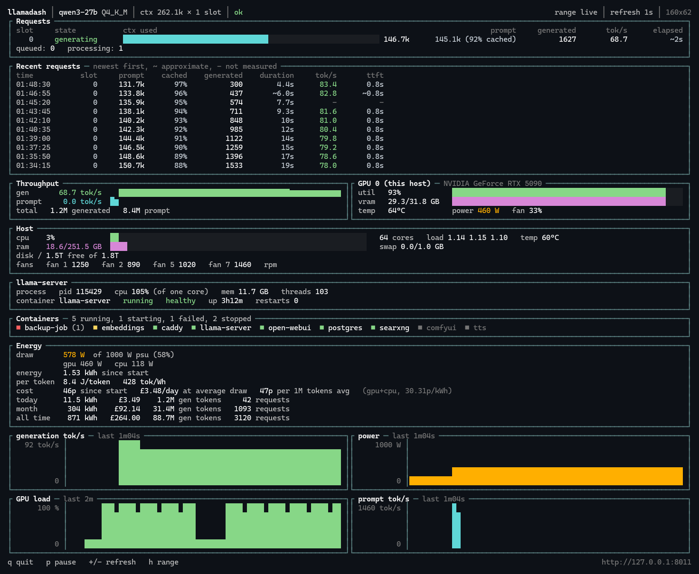
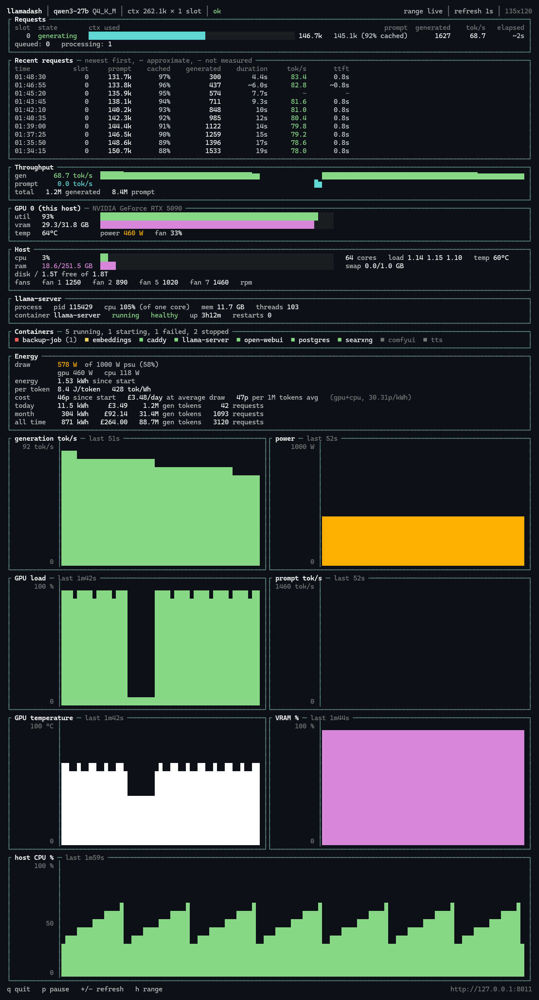
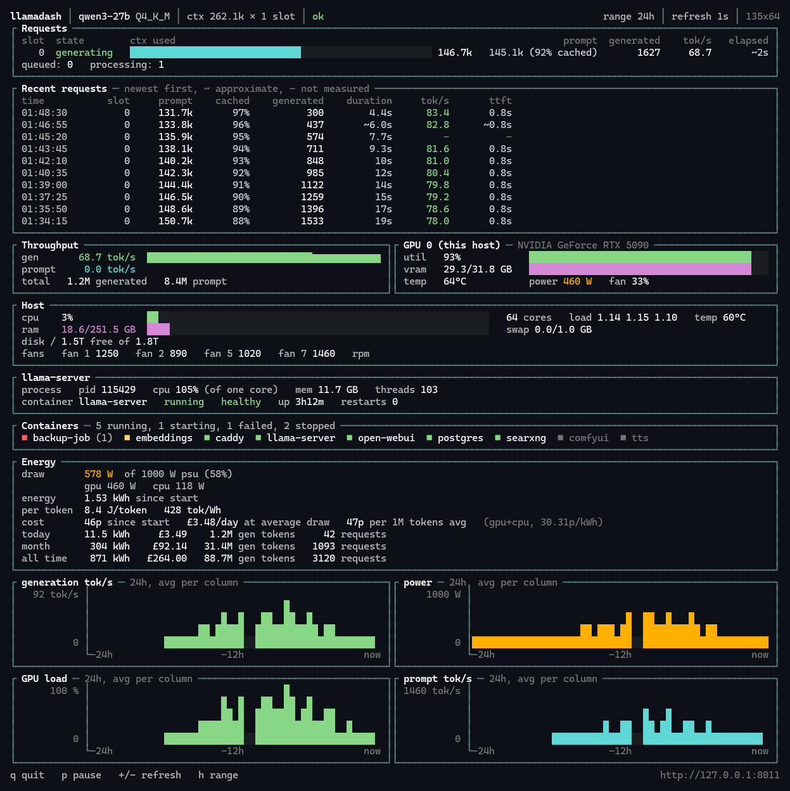
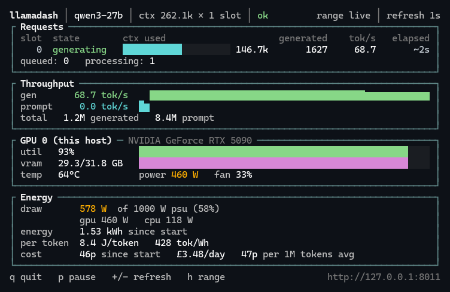

# llamadash

A dedicated dashboard for people who run inference locally: put a monitor on
the machine that runs your [llama.cpp](https://github.com/ggml-org/llama.cpp)
`llama-server` and see everything it is doing, without taking memory or VRAM
away from the model.



A desktop session, a browser and a web dashboard cost RAM, and a graphical
desktop holds VRAM that the model could be using. llamadash needs none of
them. It is one static binary that draws on the server's bare text console,
starts at boot in place of the login prompt, and shows running requests,
tokens per second, GPU, host, power draw, electricity cost and history in one
place.

- **No VRAM.** It runs on the Linux text console: no desktop, no compositor,
  no browser, nothing on the GPU.
- **Small footprint.** About 35 MB of memory and a few percent of one CPU
  core at a one-second refresh, measured on the server it was built for. One
  13 MB file, nothing else to install: no runtime, no database server, no
  agent.
- **The whole picture on one screen.** Every slot and request, throughput,
  GPU load, temperature and memory, host CPU and RAM, the llama-server
  process and its container, live power and what it costs, with charts that
  look back up to a week.
- **Made for a dedicated monitor.** It lays itself out for whatever the
  screen gives it, from 80x24 to a portrait monitor, and stays readable from
  across the room.
- **Hands off your server.** It only sends `GET` requests to the
  llama-server, and never shows or stores prompt or response text.

## At a glance

| Function | What you get | Needs |
| --- | --- | --- |
| Model and server | model name and quantisation (e.g. `Q4_K_M`), context size, slots, health | nothing extra |
| Running requests | per slot: state, context used, prompt and generated tokens, tok/s, elapsed time | nothing extra |
| Recent requests | the last finished requests with tokens, cache share, duration, tok/s, time to first token | nothing extra |
| Throughput | generation and prompt tokens per second, totals, queue depth | queue depth: server started with `--metrics` |
| GPU | load, VRAM, temperature, power, fan, per GPU | NVIDIA GPU with `nvidia-smi` |
| Host | CPU, load, CPU temperature, RAM, swap, free disk | dashboard runs on the server |
| Fans | CPU and case fan speeds; a fan that stops is flagged | a loaded hardware-monitoring driver for the motherboard (see Troubleshooting) |
| llama-server process | CPU, memory and threads of the server process | dashboard runs on the server |
| Containers | a green, amber or red light for every Docker container; amber means still starting | `docker`, as root or a `docker` group member |
| Power and energy | live watts, energy used, joules per token | GPU: `nvidia-smi`; CPU: root |
| Cost | cost so far, per day, per million tokens; today, this month, all time | a price per kWh in the settings |
| History | charts over the last 5 minutes, hour, day or week; totals survive restarts | nothing extra (built-in SQLite file) |
| Always-on display | starts at boot on the server's monitor; any screen size, portrait included | systemd, for the boot service |
| Set-up | interactive installer; one settings file | root, to install system-wide |

## Contents

- [At a glance](#at-a-glance)
- [Screenshots](#screenshots)
- [What it shows](#what-it-shows)
- [Requirements](#requirements)
- [Quick start](#quick-start)
- [Deployment manual](#deployment-manual)
  1. [Build](#1-build)
  2. [Prepare the llama-server](#2-prepare-the-llama-server)
  3. [Install the binary](#3-install-the-binary)
  4. [First run](#4-first-run)
  5. [Settings file](#5-settings-file)
  6. [Run at boot on the console](#6-run-at-boot-on-the-console)
  7. [Console set-up: portrait, font, blanking](#7-console-set-up-portrait-font-blanking)
  8. [Watching a server from another machine](#8-watching-a-server-from-another-machine)
  9. [Upgrade](#9-upgrade)
  10. [Uninstall](#10-uninstall)
  11. [Troubleshooting](#11-troubleshooting)
- [Reference](#reference): [flags](#flags), [keys](#keys),
  [charts](#charts-and-the-h-key), [cost](#cost),
  [history database](#history-database), [power readings](#gpu-and-cpu-power)
- [Privacy](#privacy)
- [Development](#development)
- [License](#license)

## Screenshots

The images are rendered from synthetic demo data by `tools/screenshots.py`,
not captured from a real server.

| Portrait console, 135x120 | Last 24 hours from the database |
| --- | --- |
|  |  |

A plain 80x24 terminal keeps the essentials:



## What it shows

- **Header**: model and its quantisation, context size, server health, chart range, refresh
  interval, and the terminal size in columns x rows.
- **Requests**: one row per slot with state, context used, prompt and
  generated token counts, tokens per second and elapsed time; queue depth when
  the server's `/metrics` endpoint is on.
- **Recent requests**: the last finished requests, newest first, with time,
  slot, prompt tokens, share served from the cache, generated tokens,
  duration, tok/s and time to first token. `~` marks an approximate value and
  `-` one that was not measured. Rows from earlier days show their date.
- **Throughput**: current generation and prompt rates, and totals.
- **GPU**: one panel per NVIDIA GPU with utilisation, memory, temperature,
  power and fan speed; temperature and memory are highlighted when high.
- **Host**: CPU use, core count, load average, CPU temperature (amber from
  85°C, red from 95°C), RAM, swap and free disk space, and a `fans` row with
  the speed of every motherboard fan (CPU and case fans) read from the kernel's
  hardware monitors. A fan header that has never reported a speed is left out
  (nothing is plugged in); a fan that has turned and then reads 0 is shown
  first, in red, as stopped. GPU fans are in the GPU panel.

  llamadash remembers the fans it has seen spinning in the settings file
  (`LLAMADASH_KNOWN_FANS`), so after a restart a known fan that reads 0 is
  flagged as stopped from the first frame, and one whose sensor is gone
  altogether (driver not loaded, header disconnected) shows as `fan 3 n/a` in
  amber, after the stopped fans and before the running ones.
- **llama-server**: the server process (pid, CPU as a share of one core,
  memory, threads), found by its command name `llama-server`, and the Docker
  container that publishes the server's port (name, state, health, uptime,
  restarts). The health is green when `healthy`, amber when `starting` and red
  when `unhealthy` (without colour: `starting!`, `unhealthy!!`).
- **Containers**: every Docker container on the machine as a status light and
  its name: green running, amber starting (health check starting, restarting,
  or the llama-server still loading its model), red failed (dead, unhealthy, or
  exited with an error code, shown in brackets), dim stopped on purpose. The
  title counts them; without colour the marks are `+`, `~`, `!` and `-`.
- **Energy**: live power in watts (GPU and CPU package) and, with the power
  supply's wattage set, its share of that (`578 W  of 1000 W psu (58%)`). With the
  wattage set the figure is green below 80% of it, amber from 80% and red from
  95%; without it the figure is plain. Each GPU's own power figure is always
  green, because a card at its limit is normal use. Also: energy since start,
  joules per token and tokens per Wh. With a price per kWh: cost since start,
  per day and per million generated tokens. With the database: energy, cost,
  generated tokens and requests for today, this month and all time.
- **Charts**: generation tok/s, power, GPU load, prompt tok/s, GPU
  temperature, VRAM % and host CPU %, live or over the last hour, day or week.

Things worth knowing:

- GPU, Host, process, container and power describe the machine the dashboard
  runs on. They are shown only when `--url` is a loopback address, or with
  `--gpu`; never with `--no-gpu`.
- A panel appears only when its data source exists. A panel whose data is
  older than three poll intervals is dimmed and shows its age ("stale, 12s
  ago"). If the server cannot be reached the header says so and the dashboard
  keeps retrying.
- On a short screen, panels are dropped in this order: charts first, then
  Recent requests, Containers, the llama-server panel, Host, the Energy totals
  and cost line; after that the Requests table shrinks and the GPU and Energy
  panels go.
- Energy and cost are GPU power plus CPU package power only. They are not
  wall power: memory, disks, fans, the power supply's losses and the rest of
  the machine are not counted, so the figures understate what the whole
  machine uses.
- Everything comes from polling, so per-request times are accurate to about
  one refresh interval, and a request shorter than one interval can be missed.

## Requirements

| For | You need |
| --- | --- |
| Running | Linux on amd64 or arm64, and a llama.cpp `llama-server` it can reach over HTTP |
| Requests and throughput | the server's `/slots` endpoint (on by default) |
| Queue depth and server token totals | the server started with `--metrics` |
| GPU panel and GPU power | NVIDIA GPU with `nvidia-smi` on the same machine |
| CPU package power | root (the kernel's RAPL counters under `/sys/class/powercap` are root-only), on a CPU that has them |
| Container line and Containers panel | the `docker` command and permission to use it (root, or a user in the `docker` group) |
| Building | Go 1.27 or newer; Python 3 for the build script |

## Quick start

On the machine that runs the llama-server:

```
git clone https://github.com/tpavesi/llamadash.git llamadash
cd llamadash
CGO_ENABLED=0 go build -o llamadash ./cmd/llamadash
sudo ./llamadash --url http://localhost:8080
```

`sudo` is what adds CPU power and the container line; without it everything
else still works. Press `q` to quit, `h` to change the chart range.

## Deployment manual

This is the full path from source to a dashboard that owns the server's
monitor from boot. Stop after step 4 if you only want to run it by hand.

**The short way:** after building (step 1), copy `dist/` to the server and run
the installer there. It asks for every setting (server address, API key,
electricity price and currency, the power supply's maximum wattage, database
location, whether to start at boot),
checks them against the server, shows what it is about to do, and then does
steps 3, 5 and 6 for you. If the kernel offers no motherboard fan speeds, it
also offers to find the sensor driver for the board: it loads the usual ones
in turn, keeps the one that reports fan speeds and sets it to load at boot
(`/etc/modules-load.d/llamadash.conf`):

```
scp -r dist user@server:
ssh -t user@server sudo sh dist/install.sh
```

Running it again offers the current settings as defaults, so it is also the
way to change one later; the chart scales the dashboard has learned
(`LLAMADASH_AXIS_*`, see Charts) are carried over. The power supply question
takes the wattage on the supply's label, for example `1000`; it fixes the top
of the power chart and adds the share of it to the Energy panel's draw. Type
`-` to skip it. The steps below do the same by hand.

Throughout, `server` is the machine running llama-server, `user` is your
account on it, and the llama-server listens on `http://localhost:8080` there.
Replace them with your own.

### 1. Build

On any machine with Go and Python 3 (it need not be the server, or Linux):

```
git clone https://github.com/tpavesi/llamadash.git llamadash
cd llamadash
python build.py
```

This runs the tests, then builds static binaries (`CGO_ENABLED=0`)
`dist/llamadash-linux-amd64` and `dist/llamadash-linux-arm64`, checks that
each is an ELF for the right architecture, and copies `contrib/` (the service
unit and the example settings file) and `install.sh` into `dist/`.

Without Python, build one binary directly:

```
CGO_ENABLED=0 GOOS=linux GOARCH=amd64 go build -o dist/llamadash-linux-amd64 ./cmd/llamadash
```

### 2. Prepare the llama-server

Nothing is required: the dashboard works from `/slots`, which llama.cpp
enables by default (it is switched off by `--no-slots`; without it the
Requests panel shows a hint).

Queue depth and the server's token totals come from `/metrics`, which is off
by default. Enable it with `--metrics`. With Docker, add it to the container's
command:

```
docker run ... ghcr.io/ggml-org/llama.cpp:server -m /models/model.gguf --port 8080 --metrics
```

or set the environment form of the flag, which the llama.cpp documentation
lists as `LLAMA_ARG_ENDPOINT_METRICS`:

```
docker run -e LLAMA_ARG_ENDPOINT_METRICS=1 ...
```

If the server needs an API key, give the dashboard the same key with
`--api-key`, the env `LLAMA_API_KEY`, or the settings file.

If the server runs in a container, publish its port on the host
(`-p 127.0.0.1:8080:8080`) and run the dashboard on the host, not in a
container: inside a container the CPU power counters and the host's
`nvidia-smi` are normally out of reach.

### 3. Install the binary

Copy the build output to the server and install the binary (use
`llamadash-linux-arm64` on an arm64 host):

```
scp -r dist user@server:
ssh user@server
cd dist
sudo install -m 755 llamadash-linux-amd64 /usr/local/bin/llamadash
llamadash --version
```

### 4. First run

Check the connection with a one-line-per-item text snapshot, then start the
dashboard:

```
llamadash --once --url http://localhost:8080
sudo llamadash --url http://localhost:8080
```

The second line is `status ok`, `status warn` or `status bad`: the worst
colour the full dashboard would show (see [Status lighting](#status-lighting)).
`--once` exits with status 1 if the server cannot be reached. Run as root for
CPU power and the container line. To see cost, add a price per kWh and its
currency:

```
sudo llamadash --url http://localhost:8080 --kwh-price 0.30 --currency GBP
```

As root, history is kept in `/var/lib/llamadash/llamadash.db`; as another user
in `~/.local/state/llamadash/llamadash.db`. `--no-db` keeps none.

### 5. Settings file

So that nothing has to be typed at each start, put the settings in a file:

```
sudo install -m 644 contrib/llamadash.conf /etc/llamadash.conf
sudoedit /etc/llamadash.conf
```

```
# /etc/llamadash.conf
LLAMADASH_URL=http://localhost:8080
LLAMADASH_KWH_PRICE=0.30
LLAMADASH_CURRENCY=GBP
```

From then on plain `llamadash` uses it, for every user and for the boot
service.

- Files read: `/etc/llamadash.conf` for everyone on the machine, then
  `~/.config/llamadash/llamadash.conf` (or
  `$XDG_CONFIG_HOME/llamadash/llamadash.conf`) for the current user, whose
  lines win. `--config PATH` or the env `LLAMADASH_CONFIG` reads that one file
  instead. Neither default file has to exist.
- Lines are `NAME=value`; a line starting with `#` is a comment. The names are
  the environment variables': `LLAMADASH_URL`, `LLAMADASH_KWH_PRICE`,
  `LLAMADASH_CURRENCY`, `LLAMADASH_DB`, `LLAMA_API_KEY` and
  `LLAMADASH_PSU_WATTS`, plus the `LLAMADASH_AXIS_*` lines llamadash writes
  itself (see Charts).
- A flag on the command line wins over the environment, which wins over the
  file.
- A misspelt name, or a file named with `--config` that does not exist, stops
  llamadash with an error (exit status 2) rather than being ignored.
- If the file holds an API key, make it readable by its owner only
  (`chmod 600`); then only that user can run the dashboard with it.

### 6. Run at boot on the console

`contrib/llamadash.service` is a systemd unit that runs the dashboard as root
on the first virtual console (tty1), in place of the login prompt, and
restarts it if it exits. As root, from the copied `dist` directory, with the
binary (step 3) and `/etc/llamadash.conf` (step 5) in place:

```
install -m 644 contrib/llamadash.service /etc/systemd/system/llamadash.service
systemctl daemon-reload
systemctl enable --now llamadash
```

What the unit does:

- takes tty1 from the login prompt (`Conflicts=getty@tty1.service`) and runs
  with `TERM=linux`;
- starts after the network and Docker; if the llama-server is not up yet the
  dashboard shows "unreachable" and keeps retrying;
- restarts after 2 seconds if the dashboard ever exits, except after a
  settings error (see below);
- keeps its database in `/var/lib/llamadash/`.

Run `systemctl restart llamadash` after editing `/etc/llamadash.conf`.

Getting a login prompt back:

- Press Alt+F2 (or F3, ...) for another virtual console with its own login.
- `systemctl stop llamadash` stops the dashboard, but tty1 stays empty until
  you start the login prompt again: `systemctl start getty@tty1`. The
  dashboard comes back at the next boot, or with `systemctl start llamadash`.

If the screen stays blank after boot: a bad value in `/etc/llamadash.conf`
(price, currency, URL, or a misspelt name) makes llamadash exit with status 2.
The service then stays failed instead of restarting in a loop, and the login
prompt on tty1 is not running either. Press Alt+F2 and log in on another
console (or use ssh), then

```
systemctl status llamadash
journalctl -u llamadash -n 20
```

show the reason. Fix the file and run `systemctl restart llamadash`.

### 7. Console set-up: portrait, font, blanking

The dashboard lays itself out from the terminal's columns x rows, which the
header shows (for example `135x120`), and re-lays out when the size changes.
On the bare console those come from the kernel and the console font, not from
the dashboard:

- **Rotation.** Add `fbcon=rotate:1` (or `fbcon=rotate:3` for the other
  direction) to the kernel command line, or rotate at run time:
  ```
  echo 1 | sudo tee /sys/class/graphics/fbcon/rotate_all
  ```
- **Text size.** Use `setfont` with a font from `/usr/share/consolefonts`, for
  example a Terminus size. A smaller font gives more columns and rows, and so
  more charts.
- **Blanking.** `setterm --blank 0` stops the console from blanking.
- **Glyphs and colour.** With `TERM=linux` the dashboard uses the 16-colour
  palette and only characters the console font has. Add `--ascii` if some
  still render wrongly; `NO_COLOR` turns colour off.

The console has no alternate screen, so the last frame stays on screen after
quitting. In a desktop session, the terminal emulator's window and font size
decide the columns x rows.

### 8. Watching a server from another machine

```
llamadash --url http://server:8080
```

From another machine you get the header, Requests, Recent requests,
Throughput and the two rate charts. GPU, Host, process, container and power
are left out, because they would describe the machine you are sitting at, not
the server. For the full picture run the dashboard on the server itself, for
example over ssh:

```
ssh -t user@server sudo llamadash
```

If the boot service is already recording on that server, this second copy
opens the history read-only (the header says `db: read-only`) so nothing is
counted twice.

### 9. Upgrade

Build the new version, copy it over and replace the binary:

```
sudo install -m 755 llamadash-linux-amd64 /usr/local/bin/llamadash
sudo systemctl restart llamadash
```

The database is upgraded in place when a newer version first opens it; the
history is kept. An older binary pointed at a database written by a newer one
runs without history and says `db: off (newer schema)` in the header.

### 10. Uninstall

```
systemctl disable --now llamadash
rm /etc/systemd/system/llamadash.service /etc/llamadash.conf /usr/local/bin/llamadash
systemctl daemon-reload
systemctl start getty@tty1
```

The database in `/var/lib/llamadash/` is not deleted by this. Delete it with
`rm -r /var/lib/llamadash` if you want the history gone.

### 11. Troubleshooting

| You see | Cause and fix |
| --- | --- |
| Header says the server is unreachable | Wrong `--url`, the server is down, or its port is not published on the host. Check with `curl http://localhost:8080/health`. The dashboard keeps retrying. |
| Requests panel shows a hint instead of slots | The server was started with `--no-slots`, or it needs an API key (`--api-key`). |
| No queue depth or server totals | `/metrics` is off; start the server with `--metrics` (step 2). |
| A chart's scale is far too tall | A spike raised it, and the raised top is remembered. Delete the chart's `LLAMADASH_AXIS_*` line from the settings file and restart (see Charts). |
| No cost figures | No price is set; there is no built-in default. Set `--kwh-price` and `--currency`, or the settings file (step 5). |
| No GPU panel | `nvidia-smi` is not on the `PATH` of the user running the dashboard, the GPU is not NVIDIA, or `--url` is not a loopback address (add `--gpu`). |
| Power shows GPU only, cost line says `(gpu, ...)` | CPU package power needs root, and a CPU with RAPL counters. |
| No container line | `docker` is missing or the user may not use it; run as root or add the user to the `docker` group. Only the container publishing the server's port is shown. |
| A red container that exited with `(128)` at boot, Docker saying "cannot assign requested address" | It was started before the network address it binds its port to existed. `docker start NAME` brings it up; publishing the port on `0.0.0.0` or `127.0.0.1` instead of a LAN address avoids it. |
| No fans row | The kernel driver for the board's sensor chip is not loaded. The installer finds and loads it (step 7 of its questions). By hand: `sensors-detect` (package `lm-sensors`) names it, commonly `nct6775` or `it87`; `sudo modprobe nct6775` loads it and adding the name to `/etc/modules` makes it permanent. Several ASRock boards need `nct6683`, and on older kernels `modprobe nct6683 force=1` (unload it first with `rmmod nct6683`). The dashboard looks again every minute. GPU fans are in the GPU panel. |
| No llama-server process line | No process with the command name `llama-server` is visible on this machine. |
| `db: off (...)` in the header | The database could not be opened; the dashboard runs without history. For `corrupt` or `not a database`: stop the dashboard, move the file aside (with its `-wal` and `-shm` files) and start again; a new one is created. |
| `db: read-only` in the header | Another llamadash is recording to the same database. This copy takes over within 30 seconds of the other one quitting. |
| `h` does nothing | There is no history database (`--no-db`, or it failed to open), or the display is paused. |
| A panel is dim with "stale, 12s ago" | Its source stopped answering; it recovers on its own when the source does. |
| Boxes or bars drawn as wrong characters | The console font lacks them; add `--ascii`. |
| `not a terminal: use --once` | The output is piped or redirected; use `--once` or `--frame COLSxROWS`. |
| Blank screen after boot | A settings error; see the end of step 6. |

To report a layout problem, attach the output of
`llamadash --frame COLSxROWS` with your terminal's size; it prints exactly one
frame and exits.

## Reference

### Flags

| Flag | Default | Meaning |
| --- | --- | --- |
| `--url` | `http://localhost:8080` | llama-server base URL (env `LLAMADASH_URL`) |
| `--api-key` | none | API key sent as a Bearer token (env `LLAMA_API_KEY`) |
| `--config` | see step 5 | settings file to read instead of the default ones (env `LLAMADASH_CONFIG`) |
| `--interval` | `1s` | poll interval, 250ms to 10s |
| `--kwh-price` | none | price of one kWh; turns on cost figures (env `LLAMADASH_KWH_PRICE`) |
| `--currency` | none | three-letter currency code of that price, e.g. `GBP` (env `LLAMADASH_CURRENCY`) |
| `--psu-watts` | none | maximum wattage of the power supply, 1 to 100000, e.g. `1000`: the top of the power chart, and the draw's share of it (env `LLAMADASH_PSU_WATTS`) |
| `--db` | see History database | history database file (env `LLAMADASH_DB`) |
| `--no-db` | off | keep no history database |
| `--retain-days` | `30` | days of samples to keep, 1 to 3650; finished requests are kept 90 days |
| `--range` | `5m` | starting chart range: `5m` (live), `1h`, `24h`, `7d` |
| `--gpu` | off | read the local GPU, CPU power, Host, llama-server process and container readings even for a non-loopback URL |
| `--no-gpu` | off | never read the local GPU, CPU power, Host, llama-server process or container readings |
| `--ascii` | off | ASCII-only output |
| `--once` | off | print one plain-text snapshot and exit (not a stable format) |
| `--frame COLSxROWS` | none | print one dashboard frame of that size and exit, e.g. `--frame 135x120` |
| `--version` | | print the version and exit |

Four settings have no flag: `LLAMADASH_AXIS_POWER_W`,
`LLAMADASH_AXIS_GEN_TPS` and `LLAMADASH_AXIS_PROMPT_TPS`, the chart tops
llamadash learns and writes into the settings file itself (any number above 0
and at most 1000000000; see Charts), and `LLAMADASH_KNOWN_FANS`, the fans it
has seen spinning, written the same way and at the same times. Unlike the
other settings, a bad value there is not an error: llamadash warns, ignores it,
learns that scale again and replaces the line at the next save.

`LLAMADASH_KNOWN_FANS` is a comma-separated list of up to 64 fans, each the
chip's name and the fan's number, e.g. `nct6683:fan1,nct6683:fan2` (a second
chip of the same name is `nct6683#2`). llamadash only ever adds to it; to forget
a fan (one you unplugged), delete its entry and restart. Malformed entries are
skipped with a warning.

`--gpu` and `--no-gpu` cannot be combined, nor `--db` and `--no-db`, nor
`--frame` and `--once`. `--once` output is for a quick look and is not a
stable format; do not parse it. `--once` and `--frame` read the database but
never write to it.

Exit codes: 0 on success; 1 if the server was unreachable for `--once` or
`--frame`, or the UI failed; 2 for bad arguments or settings (including a
`--url` that is not `http://host:port` or `https://...`), or when output is
not a terminal and neither `--once` nor `--frame` was given.

### Keys

| Key | Action |
| --- | --- |
| `q`, `Ctrl+C` | quit |
| `p` | freeze the display or show it live again; recording continues |
| `+` | poll faster |
| `-` | poll slower |
| `h` | cycle the chart range: live, 1h, 24h, 7d (only with a database) |

The interval steps through 250ms, 500ms, 1s, 2s, 5s, 10s. While the display
is frozen the dashboard keeps polling and recording (the header says
`paused (still recording)` when a database is in use), so a stray `p` never
leaves a gap in the history or the totals.

### Charts and the h key

Charts are laid out in a grid, two per row when the screen is 120 columns or
wider, and fill whatever height is left; charts that do not fit are dropped
from the end of the list. The header shows the range: `range live`, or
`range 1h`, `24h`, `7d`. `--range` sets it at start; it takes `5m` for live.

- **Live** shows one poll per column, one character cell wide: the newest
  polls, as many as the chart has columns (up to the 300 kept, about 5
  minutes at a 1 s refresh). The title says how long that covers, for example
  `last 51s` for a half-width chart on a 135-column screen.
- **1h, 24h and 7d** are read from the database, split into as many slices of
  time as the chart has columns. Each column is the average of its slice, so short spikes are flattened. Periods with no data
  (the dashboard was not running, or a sensor had no reading) are marked with
  `░`, which is different from an idle period (a bar of zero). These charts
  have a time axis. The title says `loading` until the data arrives and
  `history unavailable` if the database cannot be read.
- Percent and temperature charts (GPU load, VRAM %, host CPU %, GPU
  temperature) always use a fixed 0 to 100 scale.

**Chart scales.** The power, generation tok/s and prompt tok/s charts also
have a fixed top, so the same bar height always means the same watts or
tokens per second; the top is the label at the top of the axis, and the
Throughput panel's gen and prompt bars use the same one. A token chart's top
is the highest rate measured: rounded up to a whole number (below 10 to one
decimal), raised whenever a higher reading, live or from the history,
appears. The power chart's top is the power supply's wattage
(`--psu-watts`); without it, or when the draw goes above it, it is the
highest draw measured rounded up to the next 10 W. A top never comes down
during a run, and it is the same for every range. Raised tops are remembered for the next run:
llamadash writes them as `LLAMADASH_AXIS_POWER_W`, `LLAMADASH_AXIS_GEN_TPS`
and `LLAMADASH_AXIS_PROMPT_TPS` into the settings file it read (the
`--config` file, else the user's file, else `/etc/llamadash.conf`), at most
every 30 seconds and on quit. It changes only those lines, keeps the file's
permissions, and writes nothing without a settings file, for `--once` or
`--frame`, or (for 10 minutes) after a write failed. To reset a scale, delete
its `LLAMADASH_AXIS_*` line (a person may also edit it: any number above 0) and
restart.

### Cost

With a price per kWh the Energy panel shows cost since start, cost per day at
the average draw, cost per million generated tokens, and the tariff and power
sources it is based on, for example `(gpu+cpu, 30.00p/kWh)`. `--once` and
`--frame` cover about a second, so they show only the cost per day at the
current draw.

The currency is a three-letter code and only changes how amounts are written;
for GBP, EUR and USD amounts under one unit are shown in pence or cents. The
price in force is stored in the database each time it changes; each day's cost
is added up at the price that applied while it was recorded, so changing the
price does not rewrite past days. Energy recorded while no price was set is
not lost: it is costed at the first price you set afterwards.

Cost covers GPU plus CPU package power only, so it understates the whole
machine's electricity bill.

### History database

By default the dashboard keeps a small SQLite database so charts can look
back further than 5 minutes and totals survive a restart.

Location, first match wins: `--db PATH`; the env or setting `LLAMADASH_DB`;
for root `/var/lib/llamadash/llamadash.db`; else
`$XDG_STATE_HOME/llamadash/llamadash.db` (an absolute path only); else
`~/.local/state/llamadash/llamadash.db`. If the database cannot be opened the
dashboard still runs, without history, and the header shows `db:` and the
reason.

Only one dashboard records to a database. The one recording holds a lock on
`<database>.lock` next to the file; a second copy started while it runs opens
the database read-only: it shows the history and totals but records nothing.
It tries the lock again every 30 seconds and takes over recording once the
other copy has quit.

Samples are written in batches every 10 seconds, and the last partial window
is written when you quit.

| Table | Holds |
| --- | --- |
| `samples` | one row per 10 s window, `at` in unix ms: generation and prompt tok/s, slots processing and queued, GPU and CPU watts, GPU load, VRAM %, GPU temperature, host CPU, host memory, process CPU and RSS; a missing reading is NULL |
| `requests` | one row per finished request: time, slot, task, prompt tokens, cache share, generated tokens, duration, time to first token, tok/s, whether the figures are approximate |
| `daily` | one row per local day: generated and prompt tokens, requests, GPU and CPU Wh, cost, and how many of those Wh the cost already covers |
| `tariff` | the price and currency, each time it changed |

It holds numbers only: no prompt or response text, no command lines, no model
paths.

Retention: `samples` are kept `--retain-days` days (default 30); finished
`requests` are kept 90 days whatever `--retain-days` says. Old rows are
removed when the dashboard starts and then every 24 hours. `daily` and
`tariff` are small and are never removed, which is what keeps the all-time
totals. At the default settings a month of samples is roughly 260,000 rows.

The daily token totals are a slight undercount: polling cannot see tokens a
request produces after its last busy poll. `daily.prompt_tokens` counts prompt
tokens processed, while the Recent requests "prompt" column is cached plus
processed tokens.

The file is opened in WAL mode and may be read while the dashboard runs. It
is owned by the user who runs the dashboard, so for the boot service read it
as root:

```
sudo sqlite3 -header -column /var/lib/llamadash/llamadash.db \
  "SELECT datetime(at/1000,'unixepoch','localtime') AS t, gen_rate, gpu_w FROM samples ORDER BY at DESC LIMIT 10"
sudo sqlite3 -header -column /var/lib/llamadash/llamadash.db "SELECT * FROM daily ORDER BY day DESC LIMIT 7"
```

### GPU and CPU power

GPU readings come from `nvidia-smi` (NVIDIA only, no root needed). CPU
package power comes from the kernel's RAPL counters under
`/sys/class/powercap`, which only root can read; without them the Energy
panel uses GPU power alone and says so.

All local readings are taken only when `--url` is a loopback address
(`localhost`, `127.0.0.1`, `::1`), since they describe the machine the
dashboard runs on. Use `--gpu` to force them for another URL, or `--no-gpu` to
turn them all off.

Run the binary directly on the host. Inside a Docker container the default
AppArmor profile and masked `/sys` paths block the CPU power counters.

## Privacy

llamadash sends only `GET` requests to the llama-server (`/health`, `/props`,
`/slots`, `/metrics`) and never changes anything on it. It reads slot state
and counters only: prompt and response text, chat templates and model file
paths are never displayed, logged or stored, and server-provided strings are
stripped of control characters before display. On the local machine it reads
the llama-server process's name, CPU and memory, not its command line or
environment. It makes no other network connections.

## Development

How the program is put together is described in
[docs/ARCHITECTURE.md](docs/ARCHITECTURE.md); the rules for changing it,
for people and for AI coding agents, are in [AGENTS.md](AGENTS.md).

```
go test ./...          # all tests; no llama-server or GPU needed
python build.py        # tests, then both Linux binaries into dist/
python tools/screenshots.py   # regenerate docs/screenshots/ (needs Pillow)
```

The code is Go with [Bubble Tea](https://github.com/charmbracelet/bubbletea)
for the terminal UI and [modernc.org/sqlite](https://modernc.org/sqlite), a
pure-Go SQLite, so the binary needs no C library.

| Path | What it is |
| --- | --- |
| `cmd/llamadash` | the command: flags, settings file, database set-up |
| `internal/llama` | HTTP client and tolerant parsers for the server's endpoints |
| `internal/stats` | per-slot state, rates and finished-request tracking |
| `internal/collect` | the poll loop that gathers everything into one snapshot |
| `internal/gpu`, `cpupower`, `host`, `procstat`, `container` | local sensors |
| `internal/store` | the SQLite history |
| `internal/cost` | price parsing and money formatting |
| `internal/ui` | layout, panels, charts and the plain-text snapshot |
| `contrib/` | systemd unit and example settings file |
| `install.sh` | interactive installer for the server |
| `testdata/` | captured server responses and sensor output used by the tests |

## License

MIT; see [LICENSE](LICENSE).
